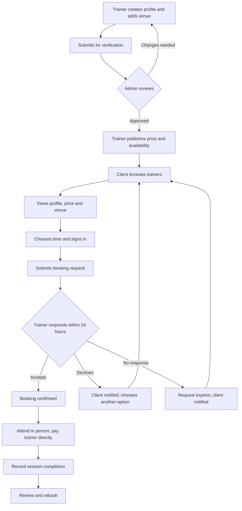
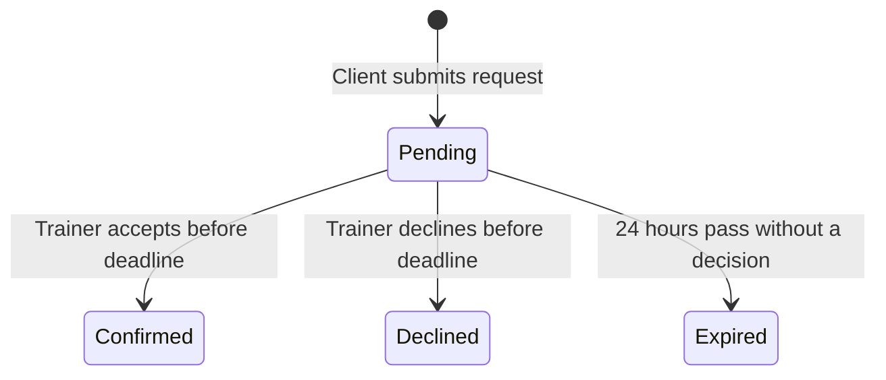

# PRD: scheduled, in-person sessions

Status: draft for review. Agreed scope is recorded below; proposals and unresolved rules are explicitly marked.
Updated: 2026-11-15

## 1. Purpose and authority

Fitness Connect helps clients find fitness trainers and arrange scheduled, in-person sessions. The first release should support a complete journey from a trainer becoming bookable to a client attending a session and returning for another booking.

This PRD defines the proposed product experience for the first release. Confirmed decisions and their rationale are in [the product decision log](../decisions/first-release.md). [Architecture.md](../../Architecture.md) remains the source of truth for technical architecture and the longer-term vision. Where older implementation plans describe a broader launch, the first-release decisions in this PRD take precedence for product scope.

This document does not split the work into implementation features, tickets, or API contracts. That is the next planning step after review.

## 2. Confirmed first-release scope

| Decision | Agreed behavior |
|---|---|
| Booking mode | Scheduled sessions; on-demand dispatch is deferred. |
| Session format | In person; online/video sessions are deferred. |
| Confirmation | A trainer must accept a client's booking request. Submission alone does not confirm a session. |
| Response window | The trainer has 24 hours from submission to accept or decline. An unanswered request expires automatically. |
| Payment | Assume the client pays the trainer directly in person. Platform payments are deferred. |

The 24-hour response window does not establish a minimum booking notice period. The previously suggested 48-hour minimum has not been approved.

## 3. Users and outcomes

| User | Desired outcome |
|---|---|
| Client | Find a suitable trainer, understand price and meeting details, request a time, and know whether the session is confirmed. |
| Trainer | Present their services, publish availability, choose which requests to accept, and see their confirmed schedule. |
| Admin | Review trainer applications and help resolve booking or session issues. Exact verification and intervention policies remain open. |

Existing client, trainer, and admin web apps provide the delivery surfaces. Mobile usability matters, particularly for clients and trainers.

## 4. Proposed user journeys

The following journeys translate the agreed scope into a proposed experience. Manual verification, public browsing, slot holds, notifications, completion reporting, reviews, and rebooking need review; they are not additional confirmed owner decisions.

### Client

1. Browse trainers and compare specialty, experience, price, venue, and availability. Browsing before sign-in is proposed.
2. Select a session and time. Review duration, total price, local date/time, venue, gym-entry charges, and cancellation terms before submitting.
3. Sign in or create an account if necessary, then submit a request.
4. See an explicit "Awaiting trainer approval" status and response deadline. Do not describe the session as booked or confirmed yet.
5. Receive acceptance, decline, or expiry information. On acceptance, see meeting instructions and "Pay the trainer in person".
6. Attend, then review and rebook if those capabilities are retained in the release.

### Trainer

1. Create an account, complete profile and venue information, and submit credentials according to the eventual verification policy.
2. After approval, publish session prices, durations, working hours, and time-off exceptions.
3. Review requests with client information, session details, and the exact response deadline.
4. Accept or decline within 24 hours. A successful acceptance produces the same confirmed booking for both participants.
5. View upcoming sessions and meeting details; record completion or report an issue according to the eventual outcome policy.

### Admin

1. Review trainer applications; approve or request changes with a reason. Approval gates visibility/bookability under the proposed policy.
2. Inspect booking details and status history when assisting users.
3. Handle reported issues within an agreed authority model. Cancellation overrides, suspensions, and disputed outcomes require explicit rules before implementation.

## 5. Proposed high-level capabilities

These describe product requirements for review, not implementation work packages.

| Area | Required experience in the proposed release |
|---|---|
| Accounts | Role-appropriate access, sign-in, registration and recovery for real users. Existing development auth is not production authentication. |
| Trainer profile and trust | Profile, specialties, experience, session offering, price, venue, verification state, and admin review. |
| Availability | Weekly hours and exceptions; show times in an explicit time zone; prevent overlapping confirmed bookings. |
| Discovery | Trainer list, basic filters, profile detail, and available session times. Maps and exact filters remain to be scoped. |
| Booking | Request, trainer acceptance/decline, 24-hour expiry, shared status, and notification of changes. Withdrawal and confirmed cancellation are distinct proposed actions. |
| Session details | Date/time, duration, preserved price, venue/address, meeting instructions, and any additional venue charge disclosed before request. |
| Notifications | Request alert, response/expiry, cancellation, and reminder. Channels and reminder timing remain open. |
| Outcomes and retention | Completion reporting, session history, reviews after attendance, and rebooking. Outcome authority and review rules remain open. |
| Admin support | Application review, booking lookup, and status history for issue investigation. |

## 6. Booking lifecycle and rules

Confirmed core lifecycle:

Proposed extensions: `Withdrawn` for a client retracting a pending request; `Cancelled` for a confirmed booking cancelled by an authorized party; session outcomes such as completed or no-show recorded separately. These require policies before implementation.

### Confirmed requirements

- Calculate the response deadline as submission time plus 24 elapsed hours, not the end of the next calendar day.
- Only the assigned trainer can approve or decline their request; clients cannot approve their own bookings.
- An unanswered request expires at the deadline and cannot subsequently be accepted. A new request is needed.
- The client must be able to distinguish pending, confirmed, declined, and expired requests.
- Payment happens directly between client and trainer in person; no platform checkout, charge, refund, payout, or platform payment confirmation is part of this release.

### Proposed safeguards and experience rules

- Hold the trainer's slot while a request is pending, releasing it on decline, expiry, or withdrawal. This is a recommendation, not an approved policy; it trades fewer conflicts for temporarily unavailable inventory.
- Prevent conflicting reservations atomically, including simultaneous acceptance and expiry. Deadline checks must use authoritative server time even if expiry processing is delayed.
- Preserve the agreed session price, duration, and venue on the request/booking. Later profile edits should not silently change an existing agreement.
- Keep a history of status changes, actor, timestamp, and relevant reason.
- Show dates in the relevant local time zone, with the zone visible; store instants in UTC as required by the architecture.
- Session completion must not imply that payment has been received. Do not create a paid/unpaid status or payment-verification workflow for the pilot.

## 7. Exceptions to design before implementation

| Situation | Proposed behavior or unresolved decision |
|---|---|
| Trainer does not respond | Confirmed: expire after 24 hours. Proposed: notify client and offer another slot/trainer. |
| Client requests a session less than 24 hours away | Open: choose minimum advance notice or an explicit shorter response deadline rule. Never leave approval pending after session start. |
| Two clients want the same time | Open hold policy; confirmed bookings must never overlap. |
| Availability changes after a request | Open: effect on pending requests and confirmed sessions; no silent cancellation. |
| Client withdraws a pending request | Proposed: release hold and notify trainer. |
| Confirmed session is cancelled | Open: who may cancel, notice cutoffs, reasons, and consequences. No automatic monetary penalties in the platform. |
| Trainer or client does not attend | Open: who reports a no-show, how disputes are handled, and impact on reviews. |
| Price or venue changes | Proposed: keep the booking agreement; material changes need participant agreement. |
| Notification fails | Proposed: the in-app status remains authoritative; delivery failure must not undo a booking decision. |

## 8. Explicitly deferred

- On-demand requests, dispatch, live trainer presence, and location tracking.
- Online/video sessions and video-provider integration.
- Platform payment collection, deposits, commissions, refunds, payouts, earnings accounting, and payment-provider onboarding.
- Native mobile apps, consistent with the existing launch architecture.

Recurring bookings, packages, chat, calendar synchronization, multiple venues per trainer, and other enhancements are not specified by this PRD. Their release placement needs review rather than implicit inclusion.

## 9. Success and release acceptance

Proposed product measures, with targets to be agreed after pilot size and instrumentation are defined:

- Submitted requests that become confirmed bookings.
- Trainer response time and requests that expire unanswered.
- Confirmed sessions reported completed, cancelled, or no-show.
- Clients who return for another booking.

Proposed release acceptance:

1. A trainer can become bookable through the agreed onboarding and verification process.
2. A client can request a published time and see it as pending, with the correct deadline.
3. Trainer acceptance produces a consistent confirmation for both participants; decline and expiry are correctly reflected.
4. Overlap and deadline races cannot produce conflicting confirmations or revive expired requests.
5. Confirmed details disclose price, venue, time zone, duration, and direct in-person payment.
6. Chosen cancellation, notification, and session-outcome flows work end to end, including failure states.
7. Real users can authenticate through production auth before a public pilot; cross-role and booking ownership access are enforced.

Metrics measure session outcomes, not revenue or verified payment collection.

## 10. Open decisions before feature breakdown

| ID | Question | Current proposal, if any |
|---|---|---|
| O1 | Minimum advance notice for booking? | 48 hours was suggested but not approved. |
| O2 | Hold a slot during a pending request? | Yes; release on decline, expiry, or withdrawal. Not approved. |
| O3 | What must trainers submit, and who can become visible/bookable? | Credentials plus manual admin review. Not approved. |
| O4 | One venue or multiple venues per trainer? | One venue for the pilot. Not approved. |
| O5 | Cancellation, withdrawal, and no-show rules? | To define. |
| O6 | Notification channels and reminder times? | To define. |
| O7 | Launch city/country, language, currency, session duration and venue-entry costs? | Single city/country and one language are existing architecture decisions; specific values remain open. |
| O8 | Who records completion and resolves disputed outcomes? | To define. |
| O9 | Public browsing, search filters, review rules, and minimum client profile? | To define. |

## 11. Next planning step

Review this PRD and its open questions, then split the agreed journey into features with dependencies and acceptance criteria. Do not treat the older trainer plan's full roadmap as first-release scope. A useful initial outcome to plan around is one approved trainer publishing availability and one client receiving an accepted booking.
