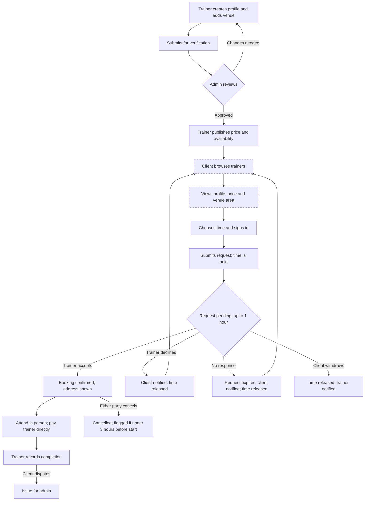
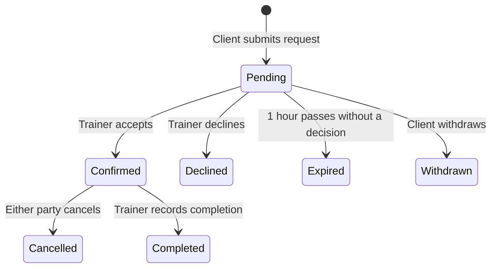

# PRD: scheduled, in-person sessions

Status: draft for review.

Updated: 2026-11-15

## 1. Purpose and authority

People who want a personal trainer have no easy way to find one nearby, see a price, and arrange a session they can trust. Trainers have no simple way to publish availability and choose which clients to take. Fitness Connect connects them. The first release supports one complete loop: a trainer becomes bookable, a client requests a time, the trainer accepts, and the session takes place and is recorded as completed.

Read this PRD together with [the product decision log](../decisions/first-release.md). Section 2 lists the owner-confirmed decisions by ID (PDR-xxx). Elsewhere, a statement that cites a PDR follows from it. Text marked "Not approved", and everything in section 10, is a proposal or an open question and carries no precedence. If the PRD and the log disagree about a confirmed decision, the log wins. The PRD governs product behavior and [Architecture.md](../../Architecture.md) governs technology. Confirmed decisions also take precedence over the broader launch described in the older plans, such as [the trainer-web plan](../plans/trainer-web.md).

This document does not split the work into implementation features, tickets, or API contracts. That is the next planning step.

## 2. Confirmed first-release scope

| Decision | Agreed behavior | ID |
|---|---|---|
| Booking mode | Scheduled sessions; on-demand dispatch is deferred. | PDR-001 |
| Session format | In person; online/video sessions are deferred. | PDR-002 |
| Confirmation | A trainer must accept a client's booking request. Submission alone does not confirm a session. | PDR-003 |
| Payment | The client pays the trainer directly in person. Platform payments are deferred. | PDR-004 |
| Response window | The trainer has 1 hour from submission to accept or decline. An unanswered request expires automatically. Replaces the earlier 24-hour window (PDR-005). | PDR-006 |
| Minimum notice | A request must be submitted at least 3 hours before the session starts. | PDR-007 |
| Slot hold | A pending request holds the trainer's time until it is accepted, declined, withdrawn or expired. No cap on pending requests per client. | PDR-008 |
| Verification | An admin approves a trainer, or asks for changes with a reason. Credentials are collected outside the app; no document upload. | PDR-009 |
| Cancellation | Either party may cancel a confirmed booking. Cancelling less than 3 hours before start is allowed but flagged in the history. No platform penalties. | PDR-010 |
| Completion | The trainer records completion. The client can dispute it, which creates an issue for the admin. | PDR-011 |
| Trainer alerts | A request alert reaches the trainer by email and in-app. | PDR-012 |
| Address disclosure | Exact address and meeting instructions are shown only after acceptance, and hidden again after cancellation. | PDR-013 |
| Availability changes | A trainer cannot save an availability change that conflicts with pending or confirmed bookings until they are resolved. | PDR-014 |
| In scope | Client withdrawal of a pending request, cancellation of a confirmed booking, and trainer-recorded completion. Reviews, rebooking and return-booking metrics are not in the first release. | PDR-015 |
| Release term | This document says "first release". Production authentication is required before any real user signs in. | PDR-016 |
| Late-cancel terms | A booking accepted less than 3 hours before start is flagged on any cancellation. The cancellation terms shown before submitting say so. | PDR-017 |
| Client overlap | When a trainer accepts a request, the client's other overlapping pending requests are withdrawn with a notice. | PDR-018 |
| Time zone | Times display in the venue's time zone, with the zone visible. | PDR-019 |

## 3. Users and outcomes

| User | Desired outcome |
|---|---|
| Client | Find a suitable trainer, understand price and meeting details, request a time, and know whether the session is confirmed. |
| Trainer | Present their services, publish availability, choose which requests to accept, and see their confirmed schedule. |
| Admin | Approve trainers or request changes, and review issues raised when a client disputes a completed session. |

Client, trainer and admin web app shells exist, each with a login screen only. All product screens are new. The admin app needs a trainer-approval screen and a view of disputed sessions. Both client and trainer apps must be usable in phone browsers. Native apps are out of scope (Architecture.md).

## 4. User journeys

Dashed steps are not approved: browsing before sign-in (O9). The loop back to browsing after a decline or expiry is a simple default, not an approved flow.

### Client

1. Browse trainers and compare specialty, experience, price, venue area and availability.
2. Select a session and time at least 3 hours ahead (PDR-007). Before submitting, see duration, price, local date and time, any venue-entry charge (O7) and the cancellation terms, including the late-cancellation flag (PDR-017).
3. Sign in or create an account if needed, then submit a request.
4. See that the request is pending and when its deadline is. Do not describe the session as booked.
5. Learn of acceptance, decline or expiry. On acceptance, see the exact address, meeting instructions and "pay the trainer in person" (PDR-004, PDR-013).
6. Withdraw a pending request (PDR-015), or cancel a confirmed booking (PDR-010).
7. After the session, dispute the completion record if it is wrong (PDR-011).

### Trainer

1. Create an account, complete profile and venue information, and submit for verification (PDR-009).
2. After approval, publish prices, durations, working hours and time-off exceptions. A change that conflicts with pending or confirmed bookings is blocked until they are resolved (PDR-014).
3. Learn of each request by email and in-app, and see client information, session details and the response deadline (PDR-012). What client information is shown is open (O9).
4. Accept or decline within 1 hour (PDR-006).
5. View upcoming sessions and meeting details, and cancel a confirmed booking (PDR-010).
6. Record completion after the session (PDR-011).

### Admin

1. Review trainer applications; approve or request changes with a reason (PDR-009).
2. Inspect a disputed session with its booking history (PDR-011).
3. Anything beyond that, such as cancellation overrides, trainer rejection or suspension, and dispute remedies, is open (O10).

## 5. High-level capabilities

These are product requirements, not work packages. "Basis" shows the decision behind each row, or "Not approved".

| Area | Required experience | Basis |
|---|---|---|
| Accounts | Sign-in, registration and recovery for real users; role-appropriate access. Existing development auth is not production authentication. | PDR-016 requires production auth. The access rules are not separately decided. |
| Trainer profile and trust | Profile, specialties, experience, price, venue, verification state, admin approval. | PDR-009 |
| Availability | Weekly hours and time-off exceptions; conflicting edits are blocked; times shown in the venue's time zone. | PDR-014, PDR-019 |
| Discovery | Trainer list, profile detail, and available session times. | Filters, maps and browsing before sign-in are not approved (O9). |
| Booking | Request, trainer accept or decline, 1-hour expiry, 3-hour minimum notice, slot hold, withdrawal. | PDR-003, PDR-006, PDR-007, PDR-008, PDR-015, PDR-018 |
| Cancellation | Either party cancels a confirmed booking; under 3 hours before start is flagged. | PDR-010, PDR-017 |
| Session details | Date and time, duration, price, venue name and area before acceptance; exact address and instructions after. | PDR-013. Keeping the agreed price after profile edits is not approved. |
| Notifications | Trainer request alert by email and in-app. Client and trainer notices of decisions, expiry, withdrawal and cancellation. | The trainer alert is PDR-012. Other notices and their channel are open (O6). |
| Outcomes | Trainer records completion; client can dispute. | PDR-011 |
| Admin support | Trainer approval, and a view of disputed sessions with history. | PDR-009, PDR-011 |

## 6. Booking lifecycle and rules

A disputed completion is an issue raised on a completed booking (PDR-011), not a separate state. No-show handling is open (O10).

### Rules

- **Deadline.** A request expires 1 hour after submission and cannot be accepted afterwards. A new request is needed (PDR-006). The 1-hour window is shorter than the 3-hour minimum notice, so a request is never still pending when the session starts.
- **Time held.** A pending request holds the trainer's time range until it is accepted, declined, withdrawn or expired (PDR-008). Another client sees that time as temporarily unavailable. An expired request never blocks a time range, even if notifications go out late.
- **No overlaps.** For one trainer, at most one active (pending or confirmed) booking exists in any time range. For one client, accepting a request withdraws their other overlapping pending requests with a notice (PDR-018).
- **Who decides.** Only the assigned trainer accepts or declines a request (PDR-003).
- **Cancellation.** Either party may cancel a confirmed booking at any time. Cancelling less than 3 hours before start is flagged (PDR-010). A booking accepted inside that window is flagged on any cancellation (PDR-017). A request submitted 3 to 4 hours before start can only be accepted after the cutoff. Exactly 3 hours counts as not flagged.
- **History.** Each booking keeps its status changes with timestamps, including the late-cancellation flag. Admin sees this history for a disputed session (PDR-010, PDR-011). Recording who acted and why is not approved.
- **Alerts.** Each trainer request alert is recorded as sent or failed, so the expiry rate can be read against delivery (not approved).
- **Visible status.** A client can tell pending, confirmed, declined, expired, withdrawn and cancelled apart.
- **Payment.** Money moves directly between client and trainer. The platform has no checkout, refund, payout or payment status, and completion does not mean payment was received (PDR-004).
- **Price and venue changes.** Keeping the agreed price, duration and venue after profile edits is not approved (O11).

## 7. Exceptions

| Situation | Behavior |
|---|---|
| Trainer does not respond | The request expires and the client is notified (PDR-006). Offering another slot or trainer is not approved. |
| Request less than 3 hours away | The time is not offered (PDR-007). |
| Two clients want the same time | The first request holds it (PDR-008). |
| Availability changes after a request | A conflicting change cannot be saved until the bookings are declined or cancelled (PDR-014). |
| Client withdraws a pending request | The hold is released and the trainer is notified (PDR-015). |
| Confirmed session is cancelled | See Cancellation in section 6. The address is hidden again (PDR-013). |
| Client disputes a completion | An issue is created for the admin with the booking history (PDR-011). Remedies are open (O10). |
| Trainer never records completion, or someone does not attend | Open (O10). |
| Notification fails | The in-app status stays authoritative. A failed delivery does not undo a booking decision. |

## 8. Explicitly deferred

- On-demand requests, dispatch, live trainer presence and location tracking (PDR-001).
- Online/video sessions and video-provider integration (PDR-002).
- Instant booking without trainer approval (PDR-003).
- Platform payments: collection, deposits, commissions, refunds, payouts, earnings accounting and provider onboarding (PDR-004).
- Reviews and rebooking (PDR-015).
- Native mobile apps (Architecture.md).

## 9. Success and release acceptance

Measures, with targets to be agreed once the number of trainers and clients is known:

- Share of submitted requests that become confirmed bookings.
- Trainer response time, and share of requests that expire unanswered, read alongside alert delivery.
- Share of confirmed sessions that end completed or cancelled, and share of completions disputed.

Release acceptance:

1. A trainer can become bookable through admin approval (PDR-009).
2. A client can request a published time at least 3 hours ahead and see it as pending (PDR-006, PDR-007).
3. Acceptance gives both participants the same confirmed booking. Decline, withdrawal and expiry each show the client the matching status.
4. A held time cannot be requested by another client. Acceptance and expiry racing cannot produce overlapping bookings or revive an expired request (PDR-008).
5. A client's other overlapping pending requests are withdrawn when one is accepted (PDR-018).
6. Confirmed details show price, duration, venue time zone and "pay the trainer in person". The exact address is not shown before acceptance and is hidden again after cancellation (PDR-013, PDR-019).
7. Each request sends the trainer an email and an in-app alert (PDR-012).
8. A trainer cannot save an availability change that conflicts with pending or confirmed bookings (PDR-014).
9. Either party can cancel a confirmed booking. A cancellation less than 3 hours before start is flagged in the history (PDR-010, PDR-017).
10. The trainer can record completion, and a client dispute creates an issue the admin can see with the booking history (PDR-011).
11. Real users sign in through production authentication, and users can reach only the bookings and screens their role allows (PDR-016).

Metrics measure session outcomes, not revenue or verified payment.

## 10. Open decisions before feature breakdown

| ID | Question | Current proposal, if any |
|---|---|---|
| O6 | Reminders before a session (channel and timing)? Which channel carries client notices? Should the 1-hour clock run around the clock, since a late-evening request can expire while the trainer sleeps? | To define. The trainer request alert is settled (PDR-012); the around-the-clock expiry is accepted for the first release. |
| O7 | Launch city and country, language, currency, session durations, and who owns venue-entry costs and whether they count toward the displayed price? | Single city/country and one language are existing architecture decisions; values are open. |
| O9 | Browsing before sign-in, search filters, maps, and the minimum client information shown to the trainer? | Browse before sign-in; basic filters. Not approved. |
| O10 | Admin authority beyond trainer approval and dispute review (cancellation overrides, trainer rejection or suspension, dispute remedies)? Completion never recorded, earliest time to record it, dispute window and issue end state? No-show reporting and handling? | To define. |
| O11 | Keeping the agreed price, duration and venue after profile edits; what counts as a material change, and how participants agree to one? | Keep the agreement. Not approved. |
| O12 | One venue or several per trainer? Recurring bookings, packages, chat and calendar sync: in or out of the first release? | One venue for the first release. Not approved. |
| O13 | Trust, safety and privacy rules for in-person sessions between strangers, including health-related data and how admin accounts are created? | To define before the first real session (Architecture.md section 9). |

## 11. Risks and mitigations

| Risk | Mitigation |
|---|---|
| Trainers miss the alert within 1 hour, or a request expires overnight | Email and in-app alerts are required (PDR-012). Alerts are recorded sent or failed so the expiry rate can be read against delivery. Reminders and the overnight case are open (O6). |
| A client holds time with several trainers or blocks a trainer's time | A hold lasts at most 1 hour, and accepting one request withdraws the client's other overlapping ones (PDR-018). A client can still withdraw and resubmit, and a hold can delay a trainer's availability edit. Rate limits are planned in Architecture.md section 9; caps are not approved. |
| Exact address seen by a client who then cancels | The address is shown only after acceptance (PDR-013). A client who has seen it keeps it. |
| A user takes a role they should not have | Trainers become bookable only after admin approval (PDR-009). How admin accounts are created is open (O13). |
| Safety of in-person sessions between strangers, and health-related data | Open (O13). |
| Payment disputes and off-platform leakage | No platform payment by design (PDR-004). Accepted for the first release. |
| Old pending requests if expiry processing runs late | An expired request never blocks a time range or gets accepted (section 6). |

## 12. Next planning step

Review this PRD and its open questions, then split the agreed journey into features with dependencies and acceptance criteria. Do not treat the older trainer plan's full roadmap as first-release scope. A suggested first outcome is one approved trainer publishing availability and one client receiving an accepted booking.

Architecture.md needs these updates at feature breakdown: the `booking` lifecycle (requested, confirmed, completed, cancelled) to the states in section 6; the separate `sessions` entity versus completion recorded on the booking; section 10 item 9 (verification default, now PDR-009) and item 10 (cancellation, now PDR-010); section 6.8 (certification documents); and the reviews reference in section 9 (now deferred, PDR-015).
