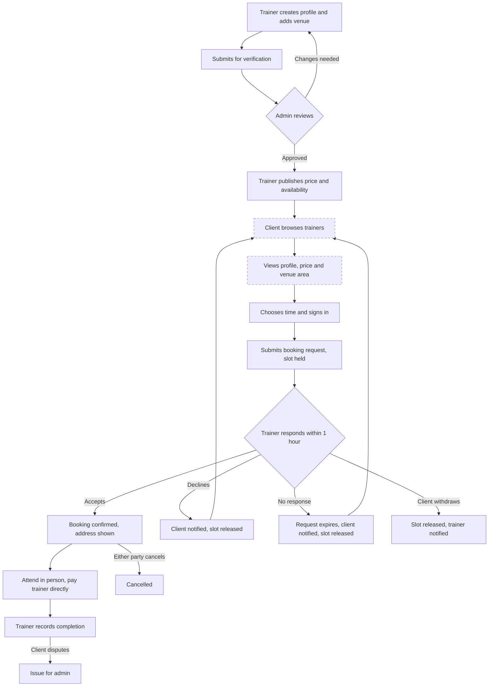
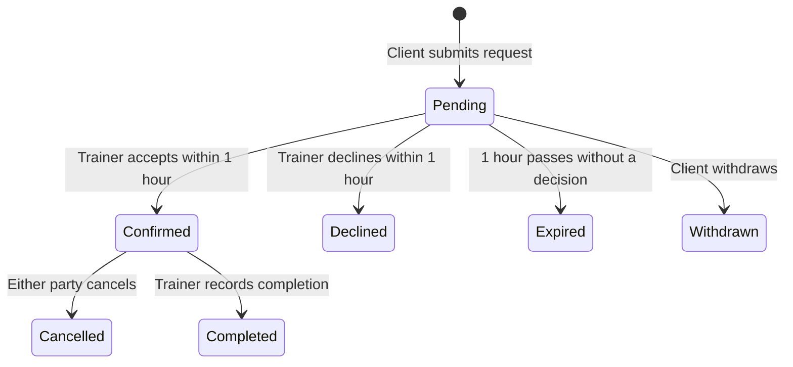

# PRD: scheduled, in-person sessions

Status: draft for review. Owner-confirmed decisions carry a decision ID (PDR-xxx) from [the product decision log](../decisions/first-release.md). Everything else is marked Derived, Proposed or Open.
Updated: 2026-11-15

## 1. Purpose and authority

Fitness Connect helps clients find fitness trainers and arrange scheduled, in-person sessions. The first release supports one complete loop: a trainer becomes bookable, a client requests a time, the trainer accepts, and the session takes place and is recorded as completed.

Status labels used in this document:

| Label | Meaning |
|---|---|
| Confirmed (PDR-xxx) | Approved by the owner and recorded in the decision log. |
| Derived | Follows directly from confirmed decisions or from Architecture.md; not a separate owner decision. |
| Proposed | Recommended experience that is not approved. |
| Open (Ox) | Undecided; listed in section 10. |

Only confirmed decisions take precedence over older plans. Proposed content carries no precedence until it is approved. The decision log holds the owner's confirmations and their consequences. If the PRD and the log disagree about a confirmed decision, the log wins. [Architecture.md](../../Architecture.md) remains the source of truth for technical architecture and the longer-term vision. Where older implementation plans describe a broader launch, confirmed decisions take precedence for product scope.

This document does not split the work into implementation features, tickets, or API contracts. That is the next planning step after review. It records confirmed decisions and open questions; the reasoning for options that were not chosen is in section 11.

## 2. Confirmed first-release scope

| Decision | Agreed behavior | ID |
|---|---|---|
| Booking mode | Scheduled sessions; on-demand dispatch is deferred. | PDR-001 |
| Session format | In person; online/video sessions are deferred. | PDR-002 |
| Confirmation | A trainer must accept a client's booking request. Submission alone does not confirm a session. | PDR-003 |
| Payment | The client pays the trainer directly in person. Platform payments are deferred. | PDR-004 |
| Response window | The trainer has 1 hour from submission to accept or decline. An unanswered request expires automatically. This replaces the earlier 24-hour window (PDR-005). | PDR-006 |
| Minimum notice | A request must be submitted at least 3 hours before the session starts. | PDR-007 |
| Slot hold | A pending request holds the trainer's slot until it is accepted, declined, withdrawn or expired. There is no cap on pending requests per client. | PDR-008 |
| Verification | An admin approves a trainer, or asks for changes with a reason. Credentials are collected outside the app; no document upload. | PDR-009 |
| Cancellation | Either party may cancel a confirmed booking up to 3 hours before start. A later cancellation is allowed but flagged in the history. | PDR-010 |
| Completion | The trainer records completion. The client can dispute it, which creates an issue for the admin. | PDR-011 |
| Trainer alerts | A request alert reaches the trainer by email and in-app. | PDR-012 |
| Address disclosure | Exact address and meeting instructions are shown only after acceptance. | PDR-013 |
| Availability changes | A trainer cannot save an availability change that conflicts with pending or confirmed bookings until they are resolved. | PDR-014 |
| In scope | Client withdrawal of a pending request, cancellation of a confirmed booking, and trainer-recorded completion. Reviews, rebooking and the "clients who return" metric are not in the first release. | PDR-015 |
| Terminology | This document says "first release". Production authentication is required before any real user signs in. | PDR-016 |

Because the response window (1 hour) is shorter than the minimum notice (3 hours), an approval is never pending at session start (Derived from PDR-006 and PDR-007).

## 3. Users and outcomes

| User | Desired outcome |
|---|---|
| Client | Find a suitable trainer, understand price and meeting details, request a time, and know whether the session is confirmed. |
| Trainer | Present their services, publish availability, choose which requests to accept, and see their confirmed schedule. |
| Admin | Approve trainers or request changes, and review issues raised when a client disputes a completed session. Intervention powers beyond that remain open (O10). |

Three web app shells (client, trainer, admin) exist, each with login only. All product screens are new. The admin app needs at least a trainer-approval screen. Mobile usability matters, particularly for clients and trainers: the web apps must work well in phone browsers (Architecture.md rules out native apps for this release).

## 4. User journeys

The flowchart shows the journey. Confirmed steps use the default style; steps drawn with a dashed border are Proposed.

Browsing before sign-in (C1, C2) is Proposed (O9). The rest follows the confirmed decisions. Sending the client back to browsing after a decline or expiry is a simple default; a prefilled "request another slot or trainer" step is Proposed.

### Client

1. Browse trainers and compare specialty, experience, price, venue area and availability. Browsing before sign-in is Proposed (O9).
2. Select a session and time at least 3 hours ahead. Review duration, price, local date and time at the venue, venue-entry charges and cancellation terms before submitting (Derived from PDR-007, PDR-010; entry charges are Open, O7).
3. Sign in or create an account if necessary, then submit a request.
4. See an explicit "Awaiting trainer approval" status and the response deadline. Do not describe the session as booked or confirmed yet. The wording is illustrative; the requirement is that the status is explicit.
5. Receive acceptance, decline, or expiry information. On acceptance, see the exact address, meeting instructions and "Pay the trainer in person" (PDR-004, PDR-013).
6. While the request is pending, withdraw it (PDR-015).
7. Before the cutoff, cancel a confirmed booking (PDR-010).
8. After the session, dispute the trainer's completion record if it is wrong (PDR-011).

### Trainer

1. Create an account, complete profile and venue information, and submit for verification (PDR-009).
2. After approval, publish session prices, durations, working hours, and time-off exceptions. A change that conflicts with pending or confirmed bookings is blocked until those are resolved (PDR-014).
3. Review requests with client information, session details, and the exact response deadline. Learn about each request by email and in-app (PDR-012). The minimum client information shown is Open (O9).
4. Accept or decline within 1 hour. A successful acceptance produces the same confirmed booking for both participants.
5. View upcoming sessions and meeting details. Cancel a confirmed booking before the cutoff.
6. Record completion after the session (PDR-011).

### Admin

1. Review trainer applications; approve or request changes with a reason (PDR-009). Rejecting or suspending a trainer is Open (O10).
2. Inspect booking details and status history when a client disputes a completion record (Derived from PDR-011).
3. Authority to override cancellations, resolve disputes, or intervene further requires explicit rules before implementation (O10).

## 5. High-level capabilities

These describe product requirements, not implementation work packages. The Status column uses the labels in section 1.

| Area | Required experience | Status |
|---|---|---|
| Accounts | Role-appropriate access, sign-in, registration and recovery for real users. Existing development auth is not production authentication. | Confirmed (PDR-016) |
| Trainer profile and trust | Profile, specialties, experience, session offering, price, venue, verification state, and admin approval. | Confirmed (PDR-009) for approval; profile content Derived |
| Availability | Weekly hours and exceptions; show times in the venue's time zone with the zone visible; prevent overlapping confirmed bookings; block conflicting edits. | Confirmed (PDR-014); no-overlap Derived from Architecture.md section 6.1 |
| Discovery | Trainer list, profile detail, and available session times. Search filters, maps, and browsing before sign-in are still to be scoped. | Open (O9) |
| Booking | Request, trainer accept or decline, 1-hour expiry, 3-hour minimum notice, slot hold, withdrawal, shared status. | Confirmed (PDR-003, PDR-006, PDR-007, PDR-008, PDR-015) |
| Cancellation | Either party cancels a confirmed booking up to 3 hours before start. | Confirmed (PDR-010) |
| Session details | Date and time, duration, price kept as agreed, venue name and area before acceptance, exact address and instructions after. | Confirmed (PDR-013); price preservation Proposed |
| Notifications | Trainer request alert by email and in-app. Response, expiry and cancellation notices to the other party. | Confirmed (PDR-012) for the trainer alert; others Derived; reminders Open (O6) |
| Outcomes | Trainer records completion; client can dispute. | Confirmed (PDR-011) |
| Admin support | Trainer approval, booking lookup and status history. | Confirmed (PDR-009); lookup and history Proposed |

## 6. Booking lifecycle and rules

A request and a booking are one record with a status. A request becomes a booking when the trainer accepts it. Completion is stored on that same record.

Confirmed core lifecycle:

### Lifecycle extensions

The `Withdrawn`, `Cancelled` and `Completed` states are Confirmed (PDR-015, PDR-010, PDR-011). Disputes are handled as an issue on a completed booking (PDR-011), not as a separate booking state. No-show handling is Open (O10).

### Confirmed and derived requirements

- Calculate the response deadline as submission time plus 1 elapsed hour (PDR-006), not a calendar boundary.
- A request is accepted only if it is submitted at least 3 hours before start (PDR-007).
- A pending request holds the slot until it is accepted, declined, withdrawn or expired (PDR-008). Another client cannot request a held slot; it shows as temporarily unavailable and reopens if the hold is released (Derived from PDR-008).
- Only the assigned trainer can accept or decline their request; clients cannot approve their own bookings (Derived from PDR-003).
- An unanswered request expires at the deadline and cannot subsequently be accepted. A new request is needed (Derived from PDR-006).
- The client must be able to distinguish pending, confirmed, declined, expired, withdrawn and cancelled bookings (Derived).
- Confirmed bookings never overlap, and acceptance is atomic. Deadline checks use authoritative server time even if expiry processing is delayed (Derived from Architecture.md section 6.1).
- Payment happens directly between client and trainer in person; no platform checkout, charge, refund, payout, or platform payment confirmation is part of this release. Session completion must not imply that payment was received, and there is no paid or unpaid status (PDR-004).
- No platform monetary penalties apply to cancellation (Derived from PDR-004).

### Proposed experience rules

- Preserve the agreed session price, duration and venue on the booking. Later profile edits should not silently change an existing agreement.
- Keep a history of status changes, actor, timestamp, and relevant reason.
- Show dates in the venue's time zone, with the zone visible. Store instants in UTC as required by the architecture. Launch uses a single configured time zone (Open, O7).

## 7. Exceptions to design before implementation

| Situation | Behavior | Status |
|---|---|---|
| Trainer does not respond | Expire after 1 hour and notify the client. Offering another slot or trainer is Proposed. | Confirmed (PDR-006); recovery Proposed |
| Client requests a session less than 3 hours away | Not allowed; the slot is not offered. | Confirmed (PDR-007) |
| Two clients want the same time | The first request holds the slot; the second client sees it as unavailable until the hold is released. | Confirmed (PDR-008) |
| Availability changes after a request | The trainer cannot save a conflicting change until affected bookings are declined or cancelled. | Confirmed (PDR-014) |
| Client withdraws a pending request | Release the hold and notify the trainer. | Confirmed (PDR-015) |
| Confirmed session is cancelled | Either party, up to 3 hours before start. A later cancellation is flagged in the history. | Confirmed (PDR-010) |
| Client disputes a completion record | An issue is created for the admin, with the booking history. The admin's remedies are Open. | Confirmed (PDR-011); remedies Open (O10) |
| Trainer or client does not attend | Who reports a no-show and how disputes are handled. | Open (O10) |
| Price or venue changes after booking | Keep the booking agreement; material changes need participant agreement. What counts as material is undefined. | Proposed; Open (O11) |
| Notification fails | The in-app status remains authoritative; delivery failure must not undo a booking decision. | Derived |

## 8. Explicitly deferred

- On-demand requests, dispatch, live trainer presence, and location tracking (PDR-001).
- Online/video sessions and video-provider integration (PDR-002).
- Instant booking without trainer approval (PDR-003).
- Platform payment collection, deposits, commissions, refunds, payouts, earnings accounting, and payment-provider onboarding (PDR-004).
- Reviews, rebooking and the "clients who return" metric (PDR-015).
- Native mobile apps, consistent with the launch architecture (Architecture.md section 7).

## 9. Success and release acceptance

Product measures, with targets to be agreed once the number of trainers and clients in the first release is known:

- Submitted requests that become confirmed bookings.
- Trainer response time and requests that expire unanswered. A high expiry rate may reflect missed alerts as much as trainer choice, so it is read alongside notification delivery.
- Confirmed sessions reported completed or cancelled, and completion records disputed by clients.

Release acceptance:

1. A trainer can become bookable through admin approval (PDR-009).
2. A client can request a published time at least 3 hours ahead and see it as pending, with a 1-hour deadline (PDR-006, PDR-007).
3. Trainer acceptance produces a consistent confirmation for both participants; decline, withdrawal and expiry are correctly reflected.
4. A held slot cannot be requested by another client, and deadline and overlap races cannot produce conflicting confirmations or revive expired requests.
5. Confirmed details disclose price, venue address, time zone, duration, and direct in-person payment, and the address is not shown before acceptance (PDR-013).
6. Trainers receive an email and an in-app alert for each request (PDR-012).
7. Cancellation up to the 3-hour cutoff, trainer-recorded completion, and a client dispute of a completion all work end to end, including failure states.
8. Real users authenticate through production auth, and cross-role and booking ownership access are enforced (PDR-016).

Metrics measure session outcomes, not revenue or verified payment collection.

## 10. Open decisions before feature breakdown

| ID | Question | Current proposal, if any |
|---|---|---|
| O4 | One venue or multiple venues per trainer? | One venue for the first release. Not approved. |
| O6 | Reminder channels and timing? Other alert channels (SMS, push)? | To define. The trainer request alert is settled (PDR-012). |
| O7 | Launch city/country, language, currency, session durations, and who owns venue-entry costs and whether they count toward the displayed price? | Single city/country, one language and a single configured time zone are existing architecture decisions; specific values remain open. |
| O9 | Browsing before sign-in, search filters, maps, minimum client information shown to the trainer? | Browse before sign-in; basic filters; to define. Not approved. |
| O10 | Admin authority beyond trainer approval and dispute review (cancellation overrides, suspensions, rejection of trainers, remedies for disputes)? No-show reporting and handling? | To define. |
| O11 | What counts as a material price or venue change, and how do participants agree to it? | To define. |
| O12 | Recurring bookings, packages, chat, calendar synchronization, and multiple venues: in or out of the first release? | Not specified by this PRD; placement needs review. |

Closed by owner decisions: O1 (PDR-007), O2 (PDR-008), O3 (PDR-009), O5 (PDR-010), O8 (PDR-011). Reviews and rebooking are out (PDR-015).

## 11. Alternatives considered

Rationale for each decision is limited to the owner's confirmation in the decision log. The trade-offs below are noted so the choice can be revisited, and they are not owner statements.

| Topic | Chosen | Alternative not chosen | Trade-off |
|---|---|---|---|
| Booking mode | Scheduled (PDR-001) | On-demand dispatch | Dispatch needs live presence and location tracking; deferred. |
| Confirmation | Trainer accepts (PDR-003) | Instant booking | Instant booking removes the wait but gives trainers no control over who they meet. |
| Payment | Direct in person (PDR-004) | Platform checkout | No payment signal, so off-platform leakage and payment disputes cannot be checked. |
| Response window | 1 hour (PDR-006) | 24 hours (PDR-005, superseded) | A shorter window gives clients a fast answer, but trainers who miss the alert lose the request, so the expiry rate depends on alert delivery. |
| Minimum notice | 3 hours (PDR-007) | 48 hours (suggested, dropped) | Short notice allows same-day sessions but leaves trainers little time to prepare. |
| Overlapping requests | Hold the slot (PDR-008) | First-accepted-wins with several pending requests | A hold gives clients certainty but lets one client block a trainer's slot for up to an hour; a cap on pending requests was considered and not adopted. |
| Verification | Admin approval flag (PDR-009) | Document upload, or no gating | Less to build than upload, but credentials are checked out of band; no gating gives no trust control. |
| Cancellation | Either party with cutoff (PDR-010) | Trainer or admin only; no cutoff | A cutoff protects trainers from late cancellations; later cancellations are still allowed, so the flag is a signal only. |
| Completion | Trainer records, client can dispute (PDR-011) | Trainer only; either party | Gives the client a voice at the cost of an admin workload. |
| Address disclosure | After acceptance (PDR-013) | Public on the profile | Protects private studios and home venues at the cost of a less informative profile. |
| Retention | Deferred (PDR-015) | Reviews and rebooking in the first release | Less to build first; return-booking behavior cannot be measured yet. |

For deferred items (video, dispatch, payments) the architecture decisions D8, D9 and D11 hold the longer-term view.

## 12. Risks and mitigations

| Risk | Mitigation or owner |
|---|---|
| Trainers miss the alert within 1 hour and requests expire | Email and in-app alerts are required (PDR-012). Watch the expiry rate. Escalating reminders are Open (O6). |
| A client holds several slots with unanswered requests | A hold lasts at most 1 hour and no cap was approved (PDR-008). Revisit if hoarding appears. |
| Exact address exposed to strangers | Address is shown only after acceptance and hidden again after cancellation (PDR-013). |
| A user becomes a trainer or admin without authorization | Trainer role requires admin approval (PDR-009). How admin accounts are created is a technical decision for Architecture.md section 6.4. |
| Safety of in-person sessions between strangers, and health-related data | Trust, safety and privacy rules are open in Architecture.md section 9 and must be defined before launch. |
| Payment disputes and off-platform leakage | No platform payment signal by design (PDR-004). Accepted for the first release. |
| Spam requests | Hold limit of 1 hour and sign-in required. No other control approved. |
| Stalled expiry processing leaves old pending requests | Deadline checks use server time at read and accept time, so a late sweep cannot revive an expired request. |

## 13. Next planning step

Review this PRD and its open questions, then split the agreed journey into features with dependencies and acceptance criteria. Do not treat the older trainer plan's full roadmap as first-release scope. A useful initial planning outcome is one approved trainer publishing availability and one client receiving an accepted booking. Update Architecture.md's `booking` lifecycle (requested, confirmed, completed, cancelled) to the states in section 6 at feature breakdown.
